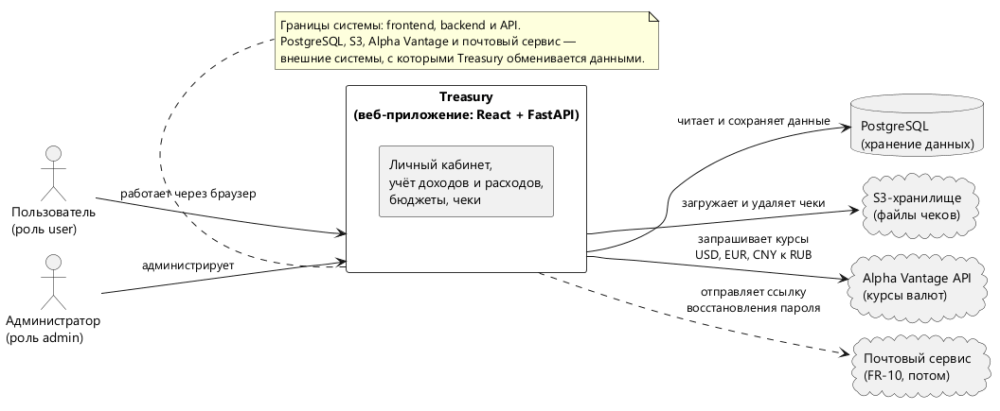
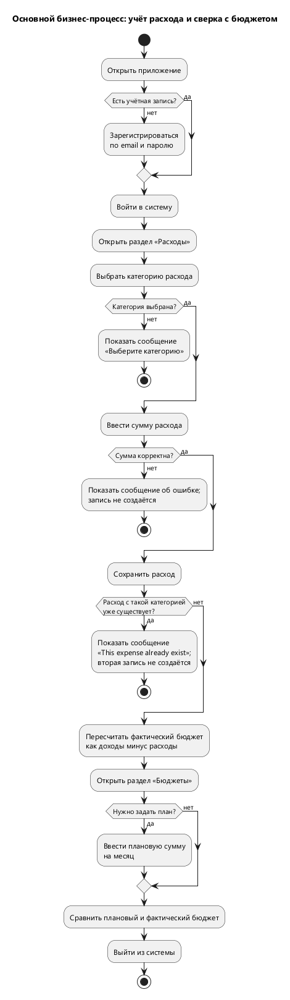
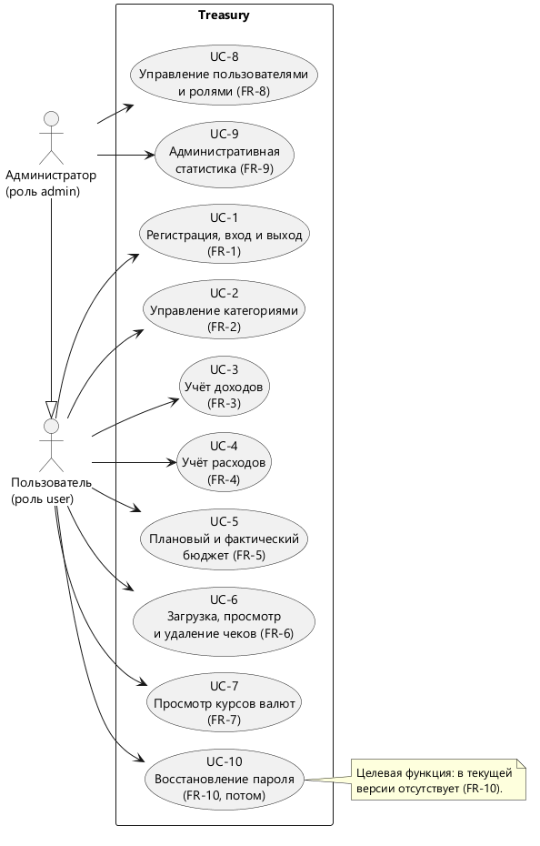
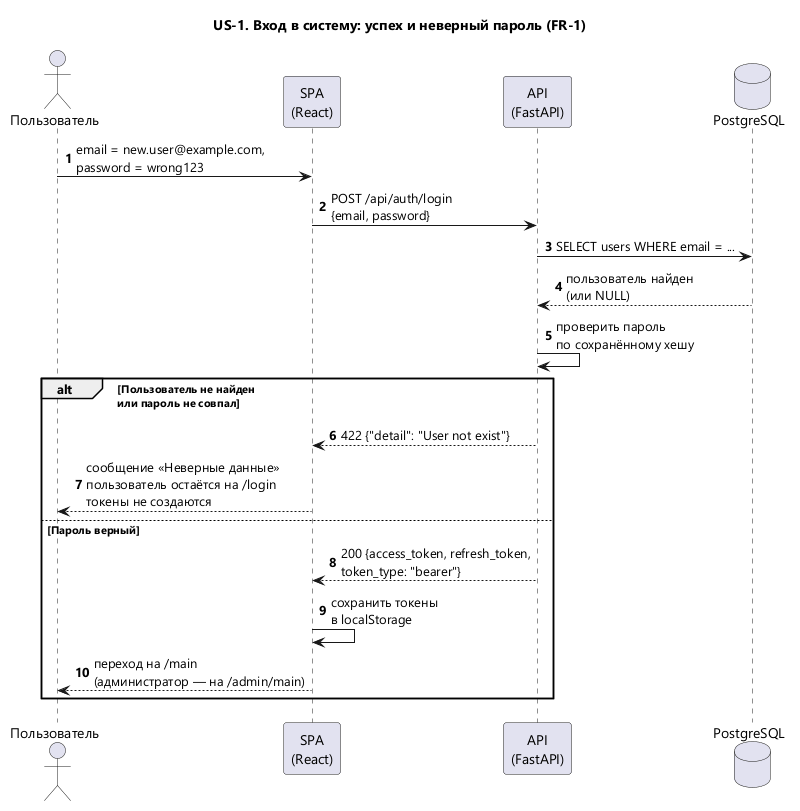
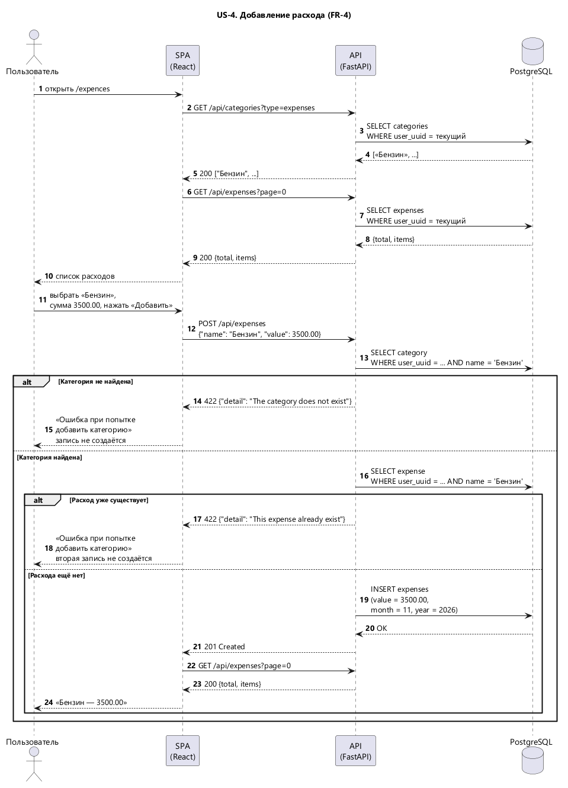
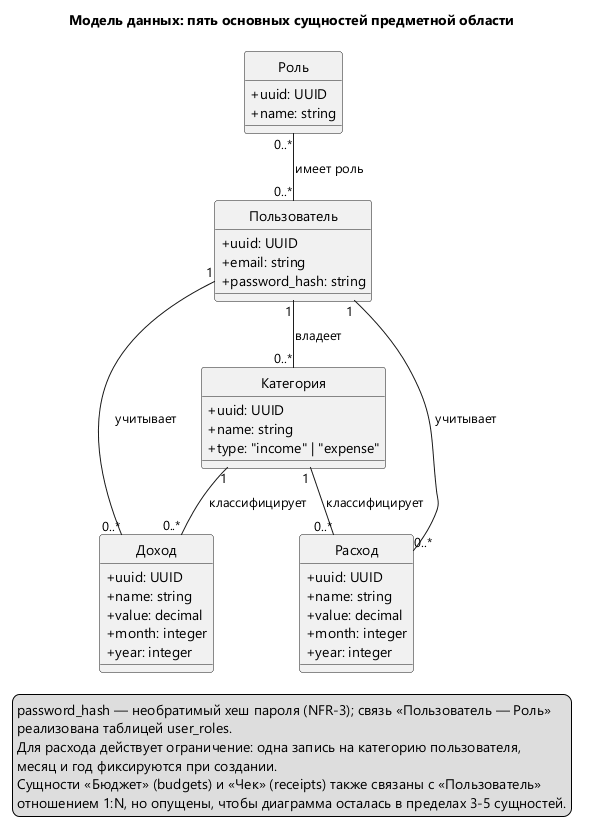
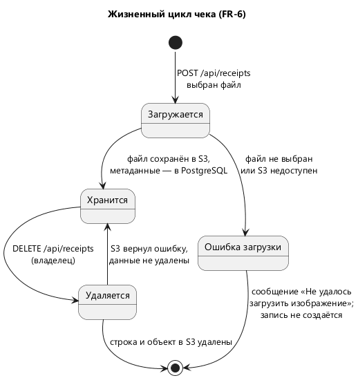

# Требования к функционалу Treasury

**Версия документа:** 1.0

Документ фиксирует, что приложение должно уметь с точки зрения пользователя. Контекст и границы проекта описаны в [паспорте проекта](00-project.md). В разделе 1 перечислены функциональные требования (FR), в разделе 2 — ограничения (NFR), в разделе 3 — пользовательские сценарии, в разделе 4 — модели системы: контекст, взаимодействие, структура и события.

## Легенда

**Приоритет**

| Значение | Смысл |
| --- | --- |
| Обязательно в этом семестре | Входит в объём семестра и должно быть выполнено до итоговой демонстрации. |
| Желательно | Выполняется после обязательных требований, если остаётся время. |
| Потом | За пределами текущего семестра. |

**Состояние**

| Значение | Смысл |
| --- | --- |
| Уже есть | Функция реализована и соответствует признаку выполнения. |
| Нужно доработать | Функция есть, но признак выполнения пока не выполняется полностью. |
| Нужно сделать | Функция отсутствует. |

## 1. Функциональные требования

| ID | Требование | Приоритет | Состояние | Признак выполнения |
| --- | --- | --- | --- | --- |
| FR-1 | Пользователь может зарегистрироваться по email и паролю, войти в систему и выйти из неё. | Обязательно в этом семестре | Уже есть | Новый пользователь создаёт учётную запись на `/register`, входит на `/login` и попадает на `/main`; неверный пароль отклоняется; после выхода токены очищаются и открывается `/welcome`. |
| FR-2 | Пользователь может создавать, переименовывать, удалять и просматривать свои категории доходов и расходов. | Обязательно в этом семестре | Нужно доработать | На `/categories` пользователь видит только свои категории, создаёт, переименовывает и удаляет категорию; запрос на изменение или удаление чужой категории возвращает `403` или `404` и не изменяет данные. |
| FR-3 | Пользователь может добавлять, изменять, удалять и искать свои доходы по категории, году и месяцу. | Обязательно в этом семестре | Уже есть | На `/incomes` пользователь добавляет доход, изменяет сумму, находит запись поиском по категории, году и месяцу и удаляет её; доходы других пользователей не отображаются. |
| FR-4 | Пользователь может добавлять, изменять, удалять и искать свои расходы по категории, году и месяцу. | Обязательно в этом семестре | Уже есть | На `/expences` пользователь добавляет расход, изменяет сумму, находит запись поиском по категории, году и месяцу и удаляет её; расходы других пользователей не отображаются. |
| FR-5 | Пользователь может задавать плановый бюджет по месяцам, видеть фактический остаток и искать бюджет по типу и году. | Обязательно в этом семестре | Уже есть | На `/budgets` пользователь сохраняет плановую сумму для выбранного месяца; после добавления дохода и расхода фактическое значение равно сумме доходов минус сумма расходов; поиск по типу и году возвращает значения по месяцам. |
| FR-6 | Пользователь может загружать чеки, открывать их по временной ссылке и удалять только свои чеки. | Обязательно в этом семестре | Нужно доработать | На `/receipts` пользователь загружает файл, видит его в списке, открывает по временной ссылке и удаляет; чужой чек по UUID недоступен для скачивания и удаления; при отказе S3 метаданные и файл не остаются в рассогласованном состоянии. |
| FR-7 | Пользователь может просматривать актуальные курсы USD, EUR и CNY к RUB. | Желательно | Нужно доработать | С настроенным ключом Alpha Vantage страница `/info` показывает курсы USD, EUR и CNY к RUB; без ключа, при ответе `429` или таймауте остальные разделы работают, а страница показывает понятное сообщение об ошибке. |
| FR-8 | Администратор может просматривать список пользователей и назначать или снимать роль администратора. | Обязательно в этом семестре | Уже есть | На `/admin/rights` администратор видит список пользователей, назначает и снимает роль администратора; учётная запись `admin@treasury.com` не может быть лишена роли; обычный пользователь получает отказ. |
| FR-9 | Администратор может получать суммарные и средние показатели доходов и расходов за выбранный год и месяц. | Обязательно в этом семестре | Нужно доработать | На `/admin/expenses` и `/admin/incomes` администратор выбирает показатель, год и месяц и получает значение; при отсутствии пользователей или операций возвращается `0`, а не ошибка `500`. |
| FR-10 | Пользователь может восстановить пароль по email, если забыл его. | Потом | Нужно сделать | На странице входа доступна ссылка восстановления; пользователь получает письмо со ссылкой, которая действует ограниченное время и позволяет задать новый пароль. |

FR-2 связан с [#3](https://github.com/Egor2341/FullStack/issues/3), FR-6 — с [#2](https://github.com/Egor2341/FullStack/issues/2) и [#4](https://github.com/Egor2341/FullStack/issues/4), FR-9 — с [#5](https://github.com/Egor2341/FullStack/issues/5). FR-10 вынесен за пределы текущего семестра и включён в раздел «Потом».

## 2. Ограничения (нефункциональные требования)

Ограничения не являются пользовательскими функциями, но задают рамки, в которых эти функции должны работать. Каждое ограничение проверяется указанным способом.

| ID | Ограничение | Как проверить |
| --- | --- | --- |
| NFR-1 | Приложение работает в последних двух мажорных версиях Chrome, Firefox и Edge на Windows, Linux и macOS и Safari на macOS при ширине окна от 1280 px; поддержка мобильных устройств и экранов уже 1280 px в этот семестр не входит. | Ручной прогон основных сценариев в четырёх браузерах на заявленных ОС при ширине окна 1280 px и 1920 px. |
| NFR-2 | Страница приложения открывается не дольше 2 секунд при локальном запуске через Docker Compose, а 95% из 100 запросов к API со списками выполняются не дольше 1 секунды при 10 параллельных пользователях. | Замер загрузки страницы и нагрузочный прогон 100 запросов к спискам при 10 параллельных пользователях; 95-й перцентиль не выше 1 секунды. |
| NFR-3 | Пароли хранятся только в виде необратимого хеша, JWT и финансовые данные передаются по HTTPS в production, а API не отдаёт и не изменяет данные пользователя с другим `user_uuid`. | Проверка схемы БД и конфигурации HTTPS; integration-тест с двумя пользователями, в котором второй пользователь не может прочитать или изменить данные первого. |
| NFR-4 | Backend работает на Python 3.12.15 и FastAPI, frontend — на React 19.2.4, TypeScript 5.9.3 и Vite 7.1.14, данные хранятся в PostgreSQL 15.19, файлы — в S3-совместимом хранилище, запуск выполняется через Docker Compose. | Сверка версий в `.tool-versions`, `package.json`, `requirements.prod.txt`, Dockerfile и CI; запуск `docker compose up --build`. |
| NFR-5 | Курсы валют зависят от Alpha Vantage и требуют API-ключа; при отсутствии ключа, ответе `429` или таймауте остальные функции приложения остаются доступны, а пользователь получает понятное сообщение об ошибке. | Тест с пустым ключом и mock-ответами `429` и таймаута; проверка, что остальные разделы и API отвечают штатно. |

## 3. Пользовательские сценарии

### US-1. Регистрация, вход и выход (FR-1) — ключевой сценарий

**Я как** будущий пользователь (после регистрации — роль `user`), **имею** email и пароль, **делаю** регистрацию, вход и выход, **получаю** учётную запись, доступ к личному кабинету и очистку сессии при выходе.

**Входные данные:**
- email `new.user@example.com`;
- пароль `StrongPass123` и его подтверждение;
- для повторного входа — те же email и пароль.

**Шаги:**
1. Открыть `/register`.
2. Ввести email, пароль и подтверждение пароля.
3. Нажать «Создать личный кабинет».
4. Открыть `/login`, ввести email и пароль и нажать «Войти».
5. Нажать «Выйти» в личном кабинете.

**Выходные данные:**
- в таблице `users` создана запись с ролью `user`;
- после входа в `localStorage` сохранены `accessToken` и `refreshToken`, открыт `/main`;
- после выхода токены очищены, открыт `/welcome`.

**Конкретный пример.** Регистрация `new.user@example.com` / `StrongPass123` завершается ответом `201` и переходом на `/login`. Вход с теми же данными возвращает `200` и `token_type: "bearer"`; в access-токене `sub` равен UUID пользователя, `roles: ["user"]`; открывается `/main`. После выхода `localStorage.accessToken` и `localStorage.refreshToken` пусты, URL — `/welcome`.

**Если данные неверны или неполны:**
- пустой пароль → сообщение «Пароль не может быть пустым», запрос не отправляется, токены не создаются;
- неверный пароль `wrong123` → ответ `422` с `detail: "User not exist"`, сообщение «Неверные данные», пользователь остаётся на `/login`;
- несовпадающие пароли при регистрации → сообщение «Проверьте пароли», запись в `users` не создаётся;
- занятый email → ответ `422`, сообщение «Пользователь с таким email уже существует», новая запись не создаётся.

### US-2. Управление категориями (FR-2)

**Я как** пользователь с ролью `user`, **имею** access-токен и список своих категорий, **делаю** создание, переименование и удаление категории, **получаю** обновлённые списки категорий расходов и доходов.

**Входные данные:**
- JWT с `roles: ["user"]`;
- название категории расходов «Продукты»;
- новое название «Продукты и быт»;
- UUID категории для изменения и удаления.

**Шаги:**
1. Открыть `/categories`.
2. В блоке «Расходы» ввести «Продукты» и нажать «Добавить».
3. Изменить название в поле на «Продукты и быт» и нажать иконку редактирования.
4. Нажать иконку удаления у категории.

**Выходные данные:**
- в `categories` появляется строка с `name="Продукты"`, `type="expenses"` и `user_uuid` текущего пользователя;
- после переименования в списке отображается «Продукты и быт»;
- после удаления категория исчезает из списка, а связанные записи расходов (для категории расходов) или доходов (для категории доходов) с тем же именем удаляются;
- в списке видны только категории текущего пользователя; запрос с UUID чужой категории не изменяет и не удаляет её (после доработки FR-2).

### US-3. Учёт доходов (FR-3)

**Я как** пользователь с ролью `user`, **имею** категорию дохода «Зарплата», **делаю** добавление, изменение, поиск и удаление дохода, **получаю** обновлённый список и результат поиска.

**Входные данные:**
- JWT с `roles: ["user"]`;
- категория «Зарплата»;
- сумма `120000.00`;
- новая сумма `125000.00`;
- период поиска: 2026 год, ноябрь.

**Шаги:**
1. Открыть `/incomes`.
2. Выбрать категорию «Зарплата», ввести `120000.00` и нажать «Добавить».
3. Изменить сумму на `125000.00` и нажать иконку редактирования.
4. Выбрать «Зарплата», 2026 год и месяц «Ноябрь», нажать «Найти».
5. Нажать иконку удаления.

**Выходные данные:**
- в `incomes` создана строка с `name="Зарплата"`, `value=120000.00`, `month=11`, `year=2026` и `user_uuid` текущего пользователя;
- после редактирования сумма в списке и в БД равна `125000.00`;
- поиск по категории, 2026 году и ноябрю показывает `125000.00`;
- после удаления запись исчезает из списка и БД;
- несколько доходов с одной категорией допускаются, каждая запись хранит месяц и год создания.

### US-4. Учёт расходов (FR-4) — ключевой сценарий

**Я как** пользователь с ролью `user`, **имею** категорию расхода «Бензин», **делаю** добавление, изменение, поиск и удаление расхода, **получаю** обновлённый список и результат поиска.

**Входные данные:**
- JWT с `roles: ["user"]`;
- категория «Бензин»;
- сумма `3500.00`;
- новая сумма `3700.00`;
- период поиска: 2026 год, ноябрь.

**Шаги:**
1. Открыть `/expences`.
2. Выбрать категорию «Бензин», ввести `3500.00` и нажать «Добавить».
3. Изменить сумму на `3700.00` и нажать иконку редактирования.
4. Выбрать «Бензин», 2026 год и месяц «Ноябрь», нажать «Найти».
5. Нажать иконку удаления.

**Выходные данные:**
- в `expenses` создана строка с `name="Бензин"`, `value=3500.00`, `month=11`, `year=2026` и `user_uuid` текущего пользователя;
- после редактирования сумма в списке и в БД равна `3700.00`;
- поиск по категории, 2026 году и ноябрю показывает `3700.00`;
- после удаления запись исчезает из списка и БД.

**Конкретный пример.** Пользователь с UUID `3f6c2a10-9b7d-4e8a-a1c4-5d2e7f901234` добавляет расход «Бензин» на `3500.00` в ноябре 2026 года: API отвечает `201`, в PostgreSQL появляется одна строка `expenses` с `month=11`, `year=2026`, `value=3500.00`, а в списке на `/expences` отображается «Бензин — 3500.00». После изменения на `3700.00` поиск по «Бензин», 2026 и «Ноябрь» возвращает `3700.00`.

**Если данные неверны или неполны:**
- пустая сумма → API получает `value: null`, возвращает `422`, интерфейс показывает «Ошибка при попытке добавить категорию», строка в `expenses` не создаётся, сумма в списке не меняется;
- повторное добавление «Бензин», когда у пользователя уже есть расход с таким именем, → ответ `422` с `detail: "This expense already exist"`, сообщение «Ошибка при попытке добавить категорию», вторая строка не создаётся;
- категория не выбрана → запрос не отправляется, запись не создаётся; в текущей версии сообщение не показывается, требуется добавить сообщение «Выберите категорию».

**Ограничение текущей модели:** на пользователя допускается одна запись расхода на категорию; месяц и год фиксируются при создании, а последующие изменения меняют только сумму.

### US-5. Плановый и фактический бюджет (FR-5)

**Я как** пользователь с ролью `user`, **имею** доходы и расходы за текущий год, **делаю** установку планового бюджета и поиск бюджета по типу и году, **получаю** плановые и фактические значения по месяцам.

**Входные данные:**
- JWT с `roles: ["user"]`;
- плановая сумма `50000.00` на ноябрь 2026 года;
- фактические данные: доходы `120000.00`, расходы `35000.00`.

**Шаги:**
1. Открыть `/budgets` — страница автоматически пересчитывает фактический бюджет текущего месяца.
2. Ввести `50000.00` в поле теоретического бюджета и нажать иконку редактирования.
3. Выбрать 2026 год и нажать «Поиск» в блоках реального и теоретического бюджета.

**Выходные данные:**
- в `budgets` появляются строки с `type="real"` и `type="theory"` для месяца «Ноябрь» и 2026 года;
- фактическое значение равно `120000.00 − 35000.00 = 85000.00`;
- плановое значение равно `50000.00`;
- поиск по типу и году возвращает значения по месяцам;
- фактический бюджет текущего месяца рассчитывается как сумма всех доходов минус сумма всех расходов пользователя.

### US-6. Загрузка чека (FR-6) — ключевой сценарий

**Я как** пользователь с ролью `user`, **имею** access-токен и файл изображения чека, **делаю** загрузку файла на `/receipts`, **получаю** запись в списке чеков и объект в S3-хранилище.

**Входные данные:**
- JWT с `roles: ["user"]`;
- файл `receipt_2026-11-05.jpg`, размер `245760` байт, MIME-тип `image/jpeg`;
- UUID пользователя `3f6c2a10-9b7d-4e8a-a1c4-5d2e7f901234`.

**Шаги:**
1. Открыть `/receipts`.
2. Выбрать файл `receipt_2026-11-05.jpg`.
3. Нажать «Загрузить».
4. Обновить страницу и проверить список чеков.

**Выходные данные:**
- в `receipts` создана строка с новым `uuid`, `object_name` вида `3f6c2a10-9b7d-4e8a-a1c4-5d2e7f901234/<новый_uuid>_receipt_2026-11-05.jpg`, `original_name="receipt_2026-11-05.jpg"`, `content_type="image/jpeg"`, `user_uuid` текущего пользователя и `created_at`;
- в S3-хранилище существует объект с тем же `object_name`;
- в списке отображается `receipt_2026-11-05.jpg`, счётчик чеков увеличивается на единицу.

**Конкретный пример.** Пользователь `3f6c2a10-9b7d-4e8a-a1c4-5d2e7f901234` отправляет `POST /api/receipts` с файлом `receipt_2026-11-05.jpg` (`image/jpeg`, `245760` байт). Ответ — `201`; в БД появляется строка с `object_name="3f6c2a10-9b7d-4e8a-a1c4-5d2e7f901234/a1b2c3d4-e5f6-4a7b-8c9d-0e1f2a3b4c5d_receipt_2026-11-05.jpg"`, а в списке на `/receipts` — элемент `receipt_2026-11-05.jpg`, счётчик `count` становится равным `1`, если до загрузки чеков не было.

**Если данные неверны или неполны:**
- файл не выбран → ожидаемое сообщение «Выберите файл», запрос не отправляется, запись в `receipts` и объект в S3 не создаются (в текущей версии кнопка молча ничего не делает — входит в доработку FR-6);
- S3-хранилище недоступно → ожидаемое сообщение «Не удалось загрузить изображение», транзакция откатывается, метаданные и файл не остаются в рассогласованном состоянии (текущая реализация сначала Commit в PostgreSQL, затем загрузка в S3 — issue #4, входит в доработку FR-6).

### US-7. Просмотр и удаление чека (FR-6)

**Я как** пользователь с ролью `user`, **имею** список своих чеков и UUID чека, **делаю** открытие временной ссылки и удаление чека, **получаю** файл или очистку списка; чужой чек остаётся недоступным.

**Входные данные:**
- JWT с `roles: ["user"]`;
- UUID собственного чека;
- UUID чужого чека.

**Шаги:**
1. Открыть `/receipts` и нажать «Скачать» у собственного чека.
2. Перейти по временной ссылке и скачать файл.
3. Нажать иконку удаления у собственного чека.
4. Выполнить запрос `GET /api/receipts/download?uuid=<чужой_uuid>` и `DELETE /api/receipts?uuid=<чужой_uuid>`.

**Выходные данные:**
- для собственного чека возвращается presigned URL со сроком действия 5 минут, файл скачивается;
- после удаления строка `receipts` и объект в S3 удаляются, счётчик чеков уменьшается;
- после доработки FR-6 для чужого чека возвращается `403` или `404`, временная ссылка не выдаётся, удаление не выполняется, интерфейс показывает «Ошибка при попытке загрузить изображение» или «Ошибка при попытке удалить»;
- после доработки FR-6 повторное скачивание удалённого чека возвращает `404`.

### US-8. Просмотр курсов валют (FR-7)

**Я как** пользователь с ролью `user`, **имею** access-токен и настроенный ключ Alpha Vantage, **делаю** открытие страницы `/info`, **получаю** курсы USD, EUR и CNY к RUB.

**Входные данные:**
- JWT с `roles: ["user"]`;
- действующий `ALPHA_VANTAGE_API_KEY`;
- доступ к внешнему API Alpha Vantage.

**Шаги:**
1. Открыть `/info`.
2. Дождаться загрузки курсов.

**Выходные данные:**
- страница показывает три значения: USD, EUR и CNY к RUB, например `USD: 92.45`, `EUR: 100.12`, `CNY: 12.78`;
- при отсутствии ключа, ответе `429` или таймауте страница показывает сообщение об ошибке, а остальные разделы приложения остаются доступны;
- понятность сообщения и кеширование результата входят в доработку FR-7.

### US-9. Управление пользователями и ролями (FR-8)

**Я как** администратор с ролью `admin`, **имею** access-токен и список пользователей, **делаю** назначение и снятие роли администратора, **получаю** обновлённые роли пользователя.

**Входные данные:**
- JWT с `roles: ["admin"]`;
- email пользователя `user2@example.com` с текущей ролью `user`.

**Шаги:**
1. Открыть `/admin/rights`.
2. Нажать иконку редактирования у `user2@example.com`, чтобы назначить роль администратора.
3. Обновить список и нажать иконку удаления, чтобы снять роль администратора.

**Выходные данные:**
- в `user_roles` появляется связь пользователя с ролью `admin`, затем она удаляется;
- в интерфейсе у пользователя появляется и исчезает метка «Администратор»;
- список не показывает `admin@treasury.com` и текущего администратора;
- учётную запись `admin@treasury.com` нельзя лишить роли администратора;
- пользователь без роли `admin` получает `403` и не может выполнить операцию.

### US-10. Административная статистика (FR-9)

**Я как** администратор с ролью `admin`, **имею** access-токен и данные пользователей, **делаю** выбор показателя, года и месяца, **получаю** сумму или среднее и количество пользователей.

**Входные данные:**
- JWT с `roles: ["admin"]`;
- показатель «Среднее»;
- 2026 год, месяц «Ноябрь»;
- данные: у пользователя A расход `1000.00`, у пользователя B расход `2500.00`.

**Шаги:**
1. Открыть `/admin/expenses`.
2. Выбрать «Среднее», 2026 год и месяц «Ноябрь».
3. Нажать «Найти».

**Выходные данные:**
- отображается `Результат: 1750.00, количество пользователей: 2`;
- при отсутствии пользователей или операций возвращается `0`, а не ошибка `500`;
- при не выбранном месяце ожидается сообщение «Выберите месяц» и отсутствие расчёта (текущая реализация с пустым месяцем приводит к ошибке — входит в доработку FR-9).

### US-11. Восстановление пароля (FR-10)

**Я как** пользователь с ролью `user`, забывший пароль, **имею** email от учётной записи, **делаю** запрос восстановления и установку нового пароля, **получаю** письмо со ссылкой и доступ с новым паролем.

**Входные данные:**
- email `user@example.com`;
- новый пароль `NewStrongPass456` и его подтверждение.

**Шаги:**
1. На `/login` нажать «Забыли пароль?».
2. Ввести email и отправить запрос.
3. Открыть письмо и перейти по ссылке.
4. Ввести новый пароль и подтверждение.
5. Войти с новым паролем.

**Выходные данные:**
- письмо со ссылкой восстановления отправлено на `user@example.com`;
- ссылка действует ограниченное время (например, 30 минут) и позволяет сменить пароль один раз;
- хеш пароля в `users` обновлён, старый пароль отклоняется, новый принимается;
- сценарий описывает целевое поведение: в текущей версии функция отсутствует и запланирована в разделе «Потом».

### Таблица «требование → сценарии»

| Требование | Сценарии |
| --- | --- |
| FR-1 | US-1 |
| FR-2 | US-2 |
| FR-3 | US-3 |
| FR-4 | US-4 |
| FR-5 | US-5 |
| FR-6 | US-6, US-7 |
| FR-7 | US-8 |
| FR-8 | US-9 |
| FR-9 | US-10 |
| FR-10 | US-11 |

Каждое требование покрыто хотя бы одним сценарием; каждый сценарий относится ровно к одному требованию. US-6 и US-7 вместе покрывают FR-6: загрузку чека и доступ к нему/удаление.

## 4. Модели системы

### 4.1. Контекст

**Диаграмма контекста** показывает границы Treasury и внешние системы, с которыми приложение обменивается данными. Внутри границы — веб-приложение (React + FastAPI), снаружи — PostgreSQL, S3-хранилище, Alpha Vantage и почтовый сервис; пользователи представлены ролями `user` и `admin`.

Файлы: [context.puml](diagrams/context.puml), [context.png](diagrams/context.png).

Диаграмма иллюстрирует FR-1, FR-6, FR-7, FR-8, FR-10 и ограничения NFR-4, NFR-5.

**Диаграмма деятельности** описывает основной бизнес-процесс «учёт расхода и сверка с бюджетом»: регистрация и вход, выбор категории, ввод суммы, сохранение расхода, пересчёт фактического бюджета, сравнение с планом и выход. Ветвления показывают поведение при отсутствии категории, некорректной сумме и повторном расходе.

Файлы: [activity-main-process.puml](diagrams/activity-main-process.puml), [activity-main-process.png](diagrams/activity-main-process.png).

Диаграмма иллюстрирует FR-1, FR-2, FR-4, FR-5 и сценарии US-1, US-2, US-4, US-5. Процесс учёта дохода (FR-3, US-3) симметричен и на диаграмме не дублируется.

### 4.2. Взаимодействие

**Диаграмма вариантов использования** связывает акторов с функциями системы; каждый вариант использования содержит ссылку на FR-n. «Администратор» наследует возможности «Пользователя» и дополнительно управляет пользователями и статистикой.

Файлы: [usecases.puml](diagrams/usecases.puml), [usecases.png](diagrams/usecases.png).

Диаграмма покрывает FR-1…FR-10 и сценарии US-1…US-11.

**Диаграмма последовательности US-1** показывает вход с неверным паролем — обработку ошибки: API возвращает `422` с `detail: "User not exist"`, интерфейс показывает «Неверные данные», токены не создаются. В альтернативной ветке — успешный вход с выдачей токенов.

Файлы: [sequence-us1-login-error.puml](diagrams/sequence-us1-login-error.puml), [sequence-us1-login-error.png](diagrams/sequence-us1-login-error.png).

Диаграмма иллюстрирует FR-1, US-1 и NFR-3.

**Диаграмма последовательности US-4** показывает добавление расхода: загрузку категорий и списка, `POST /api/expenses`, проверку категории, проверку дубликата и вставку строки. Ветви `alt` описывают ошибки «категория не найдена» и «расход уже существует».

Файлы: [sequence-us4-expense.puml](diagrams/sequence-us4-expense.puml), [sequence-us4-expense.png](diagrams/sequence-us4-expense.png).

Диаграмма иллюстрирует FR-4 и US-4.

### 4.3. Структура

**Модель данных** содержит пять основных сущностей: «Пользователь», «Роль», «Категория», «Доход» и «Расход». Показаны атрибуты и связи: у пользователя может быть несколько ролей, категорий, доходов и расходов; каждая категория классифицирует доходы или расходы. Имена сущностей совпадают с терминами раздела 1: «Роль» соответствует роли администратора (FR-8), «Категория» — категориям доходов и расходов (FR-2).

Файлы: [class-model.puml](diagrams/class-model.puml), [class-model.png](diagrams/class-model.png).

Диаграмма иллюстрирует FR-1, FR-2, FR-3, FR-4, FR-8 и NFR-3. Сущности «Бюджет» и «Чек» также связаны с пользователем, но опущены, чтобы модель осталась в требуемых пределах 3–5 сущностей; они описаны в FR-5 и FR-6.

### 4.4. События

Заявок, заказов и бронирований в Treasury нет, поэтому диаграмма состояний построена для чека — объекта с выраженным жизненным циклом: загрузка, хранение и удаление; выдача временной ссылки — операция над уже сохранённым чеком. Ошибка загрузки — отдельное конечное состояние; при ошибке S3 во время удаления чек остаётся в состоянии «Хранится».

Файлы: [state-receipt.puml](diagrams/state-receipt.puml), [state-receipt.png](diagrams/state-receipt.png).

Диаграмма иллюстрирует FR-6, US-6 и US-7.

### 4.5. Сводная таблица диаграмм

| Диаграмма | Исходник | PNG | Назначение | Требования и сценарии |
| --- | --- | --- | --- | --- |
| Контекст | [context.puml](diagrams/context.puml) | [context.png](diagrams/context.png) | Границы Treasury, роли пользователей и внешние системы | FR-1, FR-6, FR-7, FR-8, FR-10; NFR-4, NFR-5 |
| Деятельность | [activity-main-process.puml](diagrams/activity-main-process.puml) | [activity-main-process.png](diagrams/activity-main-process.png) | Основной бизнес-процесс учёта расхода и сверки с бюджетом | FR-1, FR-2, FR-4, FR-5; US-1, US-2, US-4, US-5 |
| Варианты использования | [usecases.puml](diagrams/usecases.puml) | [usecases.png](diagrams/usecases.png) | Акторы и функции системы с привязкой к требованиям | FR-1…FR-10; US-1…US-11 |
| Последовательность US-1 | [sequence-us1-login-error.puml](diagrams/sequence-us1-login-error.puml) | [sequence-us1-login-error.png](diagrams/sequence-us1-login-error.png) | Вход в систему: успех и обработка неверного пароля | FR-1, US-1; NFR-3 |
| Последовательность US-4 | [sequence-us4-expense.puml](diagrams/sequence-us4-expense.puml) | [sequence-us4-expense.png](diagrams/sequence-us4-expense.png) | Добавление расхода: успех, отсутствие категории, дубликат | FR-4; US-4 |
| Модель данных | [class-model.puml](diagrams/class-model.puml) | [class-model.png](diagrams/class-model.png) | Пять основных сущностей, их атрибуты и связи | FR-1, FR-2, FR-3, FR-4, FR-8; NFR-3 |
| Состояния чека | [state-receipt.puml](diagrams/state-receipt.puml) | [state-receipt.png](diagrams/state-receipt.png) | Жизненный цикл чека: загрузка, хранение, удаление | FR-6; US-6, US-7 |

PNG получены из исходников PlantUML 1.2026.9 командой `java -jar plantuml.jar -tpng -charset UTF-8 docs/diagrams/*.puml`; при изменении `.puml` изображения пересобираются той же командой.
